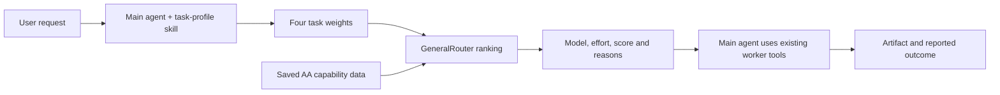

# GeneralRouter

[简体中文](README.md) · English

GeneralRouter is a task-level model selection plugin for **DeepSeek Harness (DSH)**. The main agent describes a subtask's capability requirements; GeneralRouter returns a model, a preferred reasoning effort and an explanation of the ranking. The main agent executes the recommendation through its existing tools.

**Current version: v0.1.13 experimental.**

[Watch the 43-second demo](docs/demos/generalrouter-demo.mp4) · [Demo record](docs/demos/2026-10-30.md) · [Core algorithm](docs/CORE-ALGORITHM.md) · [Design decisions](docs/DESIGN-DECISIONS.md) · [Historical comparison](docs/experiments/translation-ab-v2/README.md)



## Purpose and current scope

Development tasks vary, while models differ in capability, available usage and cost. GeneralRouter makes the model choice for each subtask explicit and preserves evidence for later evaluation. Its goal is to maintain delivery quality while reducing development time and use of constrained models. The prototype has **not established those benefits**.

The current boundary is deliberately small: **Router recommends; the main agent executes.** GeneralRouter does not choose an execution provider, authorize calls or manage task order. The main agent can use native DSH workers, Codex or Antigravity tools. Same-model repair starts a fresh worker with a short handoff; it does not require another Router call.

The plugin provides:

- Four-dimensional model capability profiles and a task-profile skill.
- Ranked model/effort recommendations with per-dimension contributions and missing-data coverage.
- Optional result records, quota information and observed usage reports.
- Workspace-aware configuration and records, without a separate orchestrator.

## Data and matching

Benchmark measurements come from **[Artificial Analysis](https://artificialanalysis.ai/models)**. GeneralRouter implements the transformations, grouping, task-profile contract and matching calculation. These are project-derived capability groups, not AA's independently published Coding or Agentic indices. Source records and attribution are retained in the [AA snapshot](data/aa-components.v0.1.json) and [third-party notices](THIRD_PARTY_NOTICES.md).

Both profiles use four named dimensions: **agentic work, coding, knowledge/document work and scientific reasoning**. They have different meanings:

- A **model vector** contains capability scores in `[0, 1]`; it does not need to sum to one. Components are transformed and aggregated using fixed recorded rules. A missing required component leaves its category unknown.
- A **task vector** expresses relative emphasis, with nonnegative weights summing to one. For ordinary tasks, the main agent estimates these weights using the definitions and [12 semantic examples](skills/generalrouter-task-profile/references/semantic-anchors.json). They are not measured task difficulty or success probabilities.

For a complete model vector, matching uses:

```text
prior = (0.30, 0.20, 0.30, 0.20)
effective_weights = 0.60 × task_weights + 0.40 × prior
score = dot(effective_weights, model_capabilities)
```

Incomplete vectors use an explicit coverage adjustment; the [algorithm document](docs/CORE-ALGORITHM.md) gives the full formula and source locations. Cost, latency, quota and difficulty do not currently affect this ranking. The fixed prior and missing-data discount are heuristics, not learned optima.

The author proposed replacing the initial nine-dimensional representation with four groups, changing the capability representation, task contract and matching interface. This was an architectural redesign, not PCA. Four historical Briefcase fits remain limited reference material; they do not establish general task calibration.

The saved candidate pool contains **12 configurations across four model families**:

| Model family | Efforts represented |
| --- | --- |
| GPT-6 Astra | low, medium, high, xhigh, max |
| GPT-6.1 Sol | low, medium, high, xhigh, max |
| Gemini 3.8 Flash | high |
| Gemini 4 Argon | high |

Each configuration has its own [recorded vector](data/model-vectors.v0.1.json); scores are not copied or interpolated between efforts. Twelve scored configurations do not imply twelve verified execution routes.

## Install and use

1. Have DSH and Python 3 installed. The Windows default Python command is `py -3`.
2. Obtain the `dsh-generalrouter-0.1.13.tgz` package. To generate it from this repository, run `py -3 scripts/package_dsh_plugin.py` from the repository root.
3. In the **DSH App**, use **Add plugin**, select the package by its full local path, and enable it.
4. Start a new session after an update so that the old routing instructions are not retained.

The package includes the plugin, Python routing code, data and skill. It does not require a copy of the source repository at runtime. The declared DSH range is `>=0.2.1-rc.2 <0.2.2-0`; source interfaces have been compared through rc.5. The version range is not a guarantee that future interfaces have been validated. See the [compatibility record](docs/DSH-COMPATIBILITY.md).

The main agent uses `generalrouter-task-profile`, then calls:

```text
generalrouter_match(profile_json, original_request, task_id?, detail?)
```

A single-task response includes `selected_model`, `selection` and `worker_request`; a multi-task response includes `tasks`. Use `detail: true` for the candidate ranking. A saved `profile_id` can be reused, or a new complete plan can be supplied directly.

The main agent resolves the recommendation through an installed execution tool. It uses the corresponding effort when supported, otherwise default with disclosure. Model access, authentication and tool permissions remain in DSH and its execution plugins. GeneralRouter does not change them. A recommendation is not proof of a successful model invocation.

`projectRoot` and `hostConfig` default to empty: the plugin follows the main session's workspace and reads built-in, shared and project-local configuration in order. Records remain in the actual workspace. See the [installation and configuration guide](dsh-generalrouter/README.zh-CN.md) for details.

## Evidence and limits

**Current demo — October 30, 2026, v0.1.13.** A CSV summary-page task used task weights `(0, 1, 0, 0)`. GeneralRouter scored all 12 configurations and recommended Argon/high. The main agent invoked one Antigravity worker, which delivered the page. The user clicked **Load example** and **Calculate** and confirmed **2 valid rows, 2 invalid rows and average score 15**.

The worker used its configured defaults; its actual model and effort were not independently confirmed. Complete usage was unavailable. The video demonstrates one recommendation-to-delivery workflow, not a performance comparison or verified recommendation fidelity. Idle footage was removed and remaining waits accelerated as labelled. [Full demo record and evidence hashes](docs/demos/2026-10-30.md).

**Historical comparison — v0.1.7.** Two runs repaired the same browser translation extension. The Router run reduced GPT-routed tokens by about 55.8%, but increased total tokens, took longer and left navigation partly untranslated. An old native-allowlist filter excluded 11 configurations, leaving Flash as the only admitted worker choice. The case did not meet the quality and time goals and cannot establish optimized selection among 12 available routes. [Report](docs/experiments/translation-ab-v2/README.md) · [Recorded results](docs/experiments/translation-ab-v2/results.json).

Optional `generalrouter_record_result`, `generalrouter_status` and `generalrouter_report` tools preserve reported outcomes and observed usage. A `selection_id` links records; it is not an execution ticket. External workers may expose no token events, so their consumption stays **unknown**, not zero. API-equivalent cost uses saved token prices and is not a subscription bill. Optional ECPA quota readings use a ten-minute activity cache and do not filter the ranking.

The present evidence does not establish general quality, speed, cost or quota savings. Historical results remain unchanged when the architecture changes.
