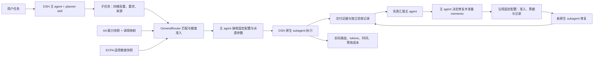

# GeneralRouter

[English project overview](docs/PROJECT-OVERVIEW.md) · [Core algorithm](docs/CORE-ALGORITHM.md) · [Design decisions](docs/DESIGN-DECISIONS.md)

GeneralRouter 是基于 DeepSeek Harness（DSH）的任务级模型路由插件，当前版本为 **v0.1.9 experimental**。它为独立子任务首次选择模型并固定配置，记录选择理由、实际调用和用量；修复由主 agent 安排，以相同配置启动新的 subagent。

DSH 主 agent 配合 planner skill 拆分任务，将任务资料提交给 GeneralRouter；主 agent 收到匹配结果后，通过 DSH 原生 `subagent` 派遣工作。

这个项目来自一个实际使用问题：强模型的订阅额度有限，其他模型的可用量更大，但不能假定它们能以相同质量完成每个开发任务。目标是让每个子任务的选模有依据，并用实际交付、时间和用量判断取舍。

**当前结果：** v0.1.7 已完成一次浏览器翻译扩展的配对开发案例。接入 Router 的一组减少了约 55.8% 的 GPT 路由 token，但总 token 增加、开发回合更长，而且目录翻译未达标；这次没有达成保质目标。后续同模型修复交接及 v0.1.9 取消 Router 原生允许列表预筛选的改动已实现，尚未运行验证。[查看实验报告](docs/experiments/translation-ab-v2/README.md) · [汇总数据](docs/experiments/translation-ab-v2/results.json) · [安装说明](dsh-generalrouter/README.zh-CN.md)



| 组件 | 职责 |
| --- | --- |
| DSH | 主 agent、会话、工具、任务编排和子 agent 执行 |
| GeneralRouter | 任务参考资料、模型能力匹配、额度准入、路由解释和用量记录 |
| EasyCLIProxyAPI（ECPA） | 模型网关及上游报告的额度状态 |

## 数据来源与架构选择

模型评测分项成绩来自 **Artificial Analysis（AA）**，类别划分与比例也参考其资料。保存的成绩见 [AA 分项快照](data/aa-components.v0.1.json)，项目生成的能力向量见 [模型向量](data/model-vectors.v0.1.json)。这些成绩不是 GeneralRouter 自行运行榜单测得的结果。

**从九维改为四维由项目作者提出，是核心架构调整。** 模型能力表示、任务权重合同和匹配计算随后统一采用 agentic、coding、knowledge/document、scientific reasoning 四个类别。这是能力表示的重新设计，不是把旧九维向量通过 PCA 等算法投影到四维；也尚未证明四维在路由效果上优于九维。

GeneralRouter 实现数据转换与聚合、任务权重流程、匹配和调用准入。普通任务权重由 planner 依据项目规则估计，不是 AA 官方提供的任务向量。详细过程见 [核心算法](docs/CORE-ALGORITHM.md) 与 [架构决策](docs/DESIGN-DECISIONS.md)。

## v0.1 范围

- 四维能力资料：agentic、coding、knowledge/document、scientific reasoning；候选池包含 12 组模型与 effort 配置。
- 使用 AA 分项成绩建立模型能力快照；planner 根据四维定义和 12 个人工语义任务锚点估计任务权重，并记录判断理由。
- 区分 planner 估计与已有 AA 样题参考拟合。只有任务信息不足或不适合四维描述时保留未知权重并显式回退，缺少 AA 同类样题本身不要求回退。
- 将匹配结果交回 DSH 主 agent；首次选择时使用已知 effort 元数据，缺失或不支持时使用模型默认设置，随后保持该配置。
- 读取 ECPA 报告的适用额度百分比；活动期间最多每十分钟自动刷新，空闲时停止刷新。
- 记录调用、重试、tokens、观测耗时和 API 等效成本；未提供的数据保留未知值。
- 默认向主 agent 返回精简结果，使用 `detail: true` 可获取细节；首次提交任务 profile 后可用返回的 `profile_id` 继续匹配。
- 每个独立任务首次选定 provider、模型和 effort 后保持固定；已结束的任务不重开。失败直接汇报主 agent，由其决定是否启动新 subagent 修复；修复沿用原配置，不重新估计权重或选择模型。
- 独立追加工作仍可保存为新任务并首次选模；修复通过专用交接工具关联原任务，保留简短 memento、已有产物和原任务约束。
- 分开记录执行状态与主 agent 报告的验收结果；修复任务可关联原任务，保留各自结果、逐任务用量与关联任务累计成本。
- 按 run 在本地保存记录失败的诊断与同项补写恢复信息，避免诊断只随一次工具回复出现。

当前匹配按能力评分、已启用的有效调用映射和额度条件选取模型，不按 DSH 原生模型目录或允许列表成员关系预筛选；缺失目录元数据不阻止匹配。DSH 在实际调用时仍负责自身权限，取消预筛选不等于接通其他执行插件，也不证明 12 组配置都能执行。成本和耗时用于记录与后续比较，尚未用于优化选择，也尚未证明能在保持质量的前提下节省资源。额度快照不能保证未来任务绝不耗尽账号。

普通任务默认使用 `weight_source: planner_estimated`：四个非负权重之和为 1，表示各类能力的相对侧重；任务难度单列，不能从权重大小推断。skill 中的人工锚点提供一致的判断示例，向量是设计者制定的启发式参考，不是 AA 测得的任务要求。资料随插件固定版本发布，后续随资料版本更新，不在任务执行时实时搜索榜单，也没有自动定期更新。

历史 AA 任务参考拟合仅覆盖四个相关商业交付样例，反映小样本模型表现的统计关联；它们继续可用，但不能当作通用语义标尺，也不能视为编程或科学任务已校准。`task-profile.v3` 扩展了权重来源，保留原有 profile 的兼容性。匹配仍采用默认 0.4 综合先验；新估计来源不构成成功率、质量保证或自动降低 effort 的规则。

## 执行与验收

主 agent 提交一次完整计划，之后用 `profile_id` 继续匹配。选中配置在该任务内固定；派遣前保留调用映射、适用额度、票据和路由身份检查，不检查原生目录或允许列表成员关系，也不会静默换模型。执行结束后，主 agent 根据子 agent 交付的证据记录 `unknown`、`passed` 或 `failed` 验收结果。记录工具不自动运行验收，`completed` 只表示执行结束。

发现问题时，失败结果和证据交给主 agent。主 agent 决定修复后，调用 `generalrouter_prepare_repair(profile_id, repairs_task_id, task_id, objective, memento, input_artifacts?, detail?)`，取得沿用原 provider/model/effort 的 `dispatch` 与新票据，再派遣新的原生 subagent。该工具负责保存关联、沿用配置、额度准入和记账，不计算新的匹配分数、不选择替代模型，也不自行启动 worker。映射或额度条件阻止派遣时汇报主 agent；DSH 调用拒绝也如实报告，不因此换模型。

memento 简述已尝试的方法、失败现象、证据和下一步，配合原代码、工作区及约束交给新 worker。修复任务有独立 ID、结果和用量；原任务不重开，原 profile 不改写。`generalrouter_append_task` 继续用于独立追加工作，不能作为修复重新选模的入口。已知验收失败的依赖仍会阻止新的下游派遣。[修复交接说明与参考来源](docs/REPAIR-HANDOFF.md)

`generalrouter_report` 分别汇总主 agent、各任务及关联修复组的用量。历史记录仅在任务、票据或子会话关联能够确定时归属，冲突或缺失保留 unknown。修复成功不会把原任务改记为通过；新任务已获得失败反例，两次执行不能直接作为同题模型对照。

## 当前运行记录与局限

用户已在 DSH 运行过加法网页、离线 CSV 分析和后续数值修复任务，路由选择、原生派遣与角色用量已有记录。v0.1.6 的 CSV 任务暴露了已结束任务不能继续修复、替换计划被拒，以及旧用量没有逐任务归属的问题。后续新会话修复中，子 agent 报告现有检查通过，主 agent 的针对性核查仍找到一个真实微小截距被归零的反例，因此未宣称全部验收通过。

v0.1.7 据此增加追加关联任务、独立验收记录与逐任务记账，保留 compact 默认回复、`profile_id` 复用和独立记录诊断。正常流程不要求主 agent 读取内部账本；主 agent 阅读必要证据，发现缺失或矛盾时补查，不自动重复整套验收。

**v0.1.8 的调整由项目作者提出：Router 只负责首次选模，失败后由主 agent 安排同模型的新 subagent 修复。** 它替代 v0.1.7 中修复新任务再次匹配的路径；匹配公式不变。此前运行与实验保留原版本口径，不作为新交接路径已经验证的证据。

**v0.1.9 按项目作者要求移除 Router 对原生 subagent 允许列表的重复预检查。** 首次匹配、固定配置重签票、修复准备和派遣授权均不再按目录成员关系排除模型；映射、额度、票据及固定路由约束保留。DSH 设置未修改，实际调用仍服从宿主权限。

用户随后运行了 v0.1.7 的短流程：两个子任务依次完成，追加任务沿用原 profile，实际路由与选择一致，并有逐任务用量；修复关联分支未覆盖。这是用户提供的运行记录，不代表全部路径都已验证。

2026-10-20 的翻译扩展案例进一步比较了 DSH 默认继承模型与接入 GeneralRouter 两种开发方式。两组各运行一个开发子 agent，随后由用户进行浏览器人工验收。A 的目录目标覆盖更完整；B 的目录翻译仍不完整。两组交互操作均获用户确认，未执行全页、窄窗口或跨浏览器验收。详见[范围、结果与局限](docs/experiments/translation-ab-v2/README.md)。

开发与本次更新没有新增自动测试、代码 review、编译校验、模拟路由或模型试调用。公开榜单题评测仍未执行。静态的 12 组能力资料、原生 subagent 允许列表和其他执行插件的模型范围是不同层次，不能混为同一个候选列表。

## 构建与使用

目标宿主为 DSH Desktop `0.2.1-rc.2`，本机需要 Python 3。在仓库根目录生成安装包：

```text
py -3 scripts/package_dsh_plugin.py
```

生成的 `dsh-generalrouter-0.1.9.tgz` 位于仓库根目录。通过 DSH App 的 **Add plugin** 输入该文件在本机的绝对路径，安装并启用；已有安装通过 App 插件管理更新包并新建会话，本机配置继续保留。打包命令只生成发布文件，不运行模型。

插件在各会话中提供包内 planner skill；本机连接配置共用 `$DSH_HOME/generalrouter/host.local.json`（未设置 `DSH_HOME` 时为 `~/.dsh/generalrouter/host.local.json`）。换工作区后新建会话即可，无需复制配置或 skill。项目根目录下的同名配置和 skill 可覆盖共享默认，用量与任务记录始终保存在实际工作区。首次接入仍需配置 DSH provider、子模型允许列表和 ECPA 管理连接；缺失额度连接时保留 unknown，不阻止内置默认模型匹配。详见[插件安装说明](dsh-generalrouter/README.zh-CN.md)。

## 接下来的范围

v0.1.9 保留能力向量、首次匹配公式和同模型修复，取消 Router 的原生目录预筛选。此次没有新增实验，也不根据单次结果调整权重。后续真实使用优先记录不同调用入口的候选覆盖、失败类型及逐任务结果，再决定是否加入成本、耗时或 effort 选择策略。尚未实现跨执行插件派遣、自动学习、自动升级模型或额度消耗预测。
