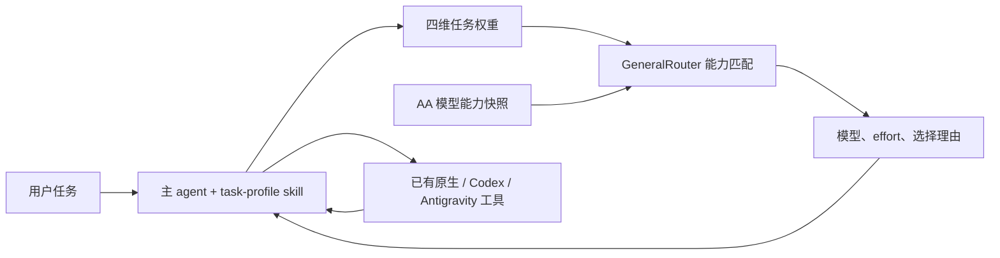

# GeneralRouter

GeneralRouter 是 DeepSeek Harness（DSH）的任务级模型选择插件，当前版本 **v0.1.13 experimental**。主 agent 提供任务向量，Router 返回模型、首选 effort 和评分理由；主 agent 使用已有工具执行。

## 为什么做这个项目

不同模型的能力、可用额度和使用成本不同。项目尝试把子任务需求与模型能力进行明确的匹配，并保存真实交付结果供之后评估。目标是保质、缩短工期和减少受限模型用量；当前原型尚未证明这些目标已经实现。

**v0.1.13 按作者提出的边界收缩：Router 只选模。** 删除派发授权、原生入口限制、票据、任务状态锁和修复准备流程。调用工具、任务顺序与失败处理由主 agent 负责；失败后的修复沿用同模型并新开 subagent，不需要 Router 再次匹配。

## 数据与算法

- 模型分项成绩来自 **Artificial Analysis（AA）**，类别与综合比例参考其资料；不是本项目自行跑榜的结果。
- 从九维转为四维由项目作者提出，是核心架构调整。四维是 agentic、coding、knowledge/document、scientific reasoning；这不是 PCA 投影，也没有九维/四维效果对照。
- 候选池有 12 组模型与 effort 配置。模型向量见 [数据文件](data/model-vectors.v0.1.json)，来源见 [AA 分项快照](data/aa-components.v0.1.json)。
- 普通任务权重由主 agent 依据四维定义及 12 个人工语义锚点估计；非负、总和为 1。任务权重表达能力侧重，不代表难度或成功率。
- 匹配保留 0.4 综合先验，按加权点积及缺项覆盖规则排名；成本、时间和难度尚未加入评分。

详见 [核心算法](docs/CORE-ALGORITHM.md)、[架构决策](docs/DESIGN-DECISIONS.md)。四个历史 AA Briefcase 拟合锚点仅是小样本参考，不构成通用任务校准。

## 使用

主 agent 调用 `generalrouter_match(profile_json, original_request, task_id?, detail?)`。单任务返回 `selected_model`、`selection` 和 `worker_request`；多任务返回 `tasks`。`detail: true` 提供候选排名。保存成功时可用 `profile_id` 复用，也可直接提交新计划。

主 agent 自己解析调用工具和实际型号；相应 effort 受支持时使用，否则使用 default 并披露。GeneralRouter 不绑定 ECPA、不检查调用入口或允许列表、不签发执行票据，也不替代 DSH 的权限机制。选中某模型不等于已经调用成功。

`generalrouter_record_result`、`generalrouter_status`、`generalrouter_report` 是可选记录工具。`selection_id` 是记录关联，不是票据。自动用量只覆盖收到的 DSH 会话事件；插件子 agent 不暴露的 token 数据保持 unknown，报告为观测小计而非保证完整的全流程账单。ECPA 额度保留十分钟活动缓存，作为参考展示，不过滤当前排名。

## 已有证据

v0.1.7 做过一次浏览器翻译扩展的配对开发案例。B 组减少约 55.8% 的 GPT 路由 token，但总 token 增加、开发回合更长，目录翻译也未达标，因此没有达成保质和缩短工期目标。该次 12 组均被评分，11 组被旧原生允许列表预筛选排除，实际只执行了 Flash；不能描述为跨三个入口选出了最优模型。

见 [实验报告](docs/experiments/translation-ab-v2/README.md) 和 [原始汇总](docs/experiments/translation-ab-v2/results.json)。历史结果不因新版架构改变而改写。v0.1.13 没有运行测试、review、编译/导入校验、模拟或模型试调用；跨插件实际调用及记录覆盖尚未验证。

## 安装

使用 DSH App 的 **Add plugin** 添加 `dsh-generalrouter-0.1.13.tgz` 的本机绝对路径。需要 Python 3，Windows 默认 `py -3`。源码目录内运行 `py -3 scripts/package_dsh_plugin.py` 可生成安装包；不会自动安装或运行模型。

DSH 版本范围为 `>=0.2.1-rc.2 <0.2.2-0`，当前源码对照到 rc.5。范围许可不保证未来接口已经验证。[安装说明](dsh-generalrouter/README.zh-CN.md) · [兼容记录](docs/DSH-COMPATIBILITY.md) · [同模型修复交接](docs/REPAIR-HANDOFF.md)

模型调用使用现有 DSH/插件配置。工作区与共享配置自动定位，记录留在实际工作区；更新后新建会话，避免旧系统提示继续要求票据或原生派发。
