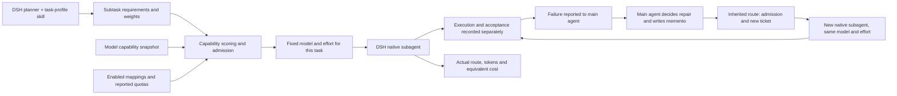

# GeneralRouter

**Task-level model routing for DeepSeek Harness · v0.1.9 experimental**

GeneralRouter is a plugin that matches independent development subtasks to model configurations once and records what happened after selection. Failures return to the main agent; repairs use fresh native subagents with the same fixed configuration. It separates capability scoring, execution constraints, acceptance outcomes and resource use, so a completed model call does not automatically count as a successful task.

[中文项目说明](../README.md) · [Core algorithm](CORE-ALGORITHM.md) · [Design decisions](DESIGN-DECISIONS.md) · [Case study](experiments/translation-ab-v2/README.md)

## The problem

Strong subscription models have limited allowances. Other models may offer more usage but may not meet every task's requirements. The goal is to preserve output quality while reducing development time and keeping subscription use within an available allowance. These goals have not yet been demonstrated by the prototype.

## What the prototype does

DeepSeek Harness (DSH) supplies the main agent, sessions, tools and worker execution. GeneralRouter adds the task profile, candidate matching, reported-quota admission and execution records.

- **Four capability dimensions:** agentic work, coding, knowledge/document work and scientific reasoning. The planner estimates their relative importance using documented semantic examples. The weights are not measured task difficulty or success probabilities.
- **Twelve model/effort configurations across four model families:** capability records come from retained Artificial Analysis data. A score is distinct from permission to execute that configuration.
- **A stable task history:** a task's selected provider, model and effort stay fixed. If the main agent arranges a repair, a new linked task inherits that configuration without reranking or generating new weights. The original outcome and each repair's resource use remain separate. Mapping/quota blocks and actual host rejections are reported without switching models.
- **Host-owned native permissions:** v0.1.9 does not prefilter candidates by DSH native-catalog or allowlist membership. Enabled valid mappings, quota admission, ticket checks and route identity remain. DSH can still reject the actual invocation; no cross-plugin dispatch is added.
- **Observable execution:** selected and actual routes, reported token usage, acceptance records and API-equivalent cost are kept separately. Missing measurements stay unknown.

Cost and time are currently recorded for comparison; they are not optimization terms in the selection policy. Reported quota snapshots cannot guarantee that an account will never run out.

The project author proposed the nine-to-four-dimensional redesign, the v0.1.8 first-selection-only repair architecture and removal of Router's native membership prefilter in v0.1.9. A short memento carries prior attempts, failures, evidence and next steps into the new worker alongside existing files and constraints. The [repair handoff](REPAIR-HANDOFF.md) and latest admission change are implemented but have not been runtime-verified; the case below remains a v0.1.7 observation.

## Core implementation

The project's core implementation consists of three connected modules:

1. **Model-vector construction:** normalize recorded benchmark components, aggregate them into four capability groups, bind each vector to an exact model/effort configuration, and retain missing-data coverage and source provenance.
2. **Task-weight processing:** define the planner's semantic reference rules and profile contract, keep estimated and fitted sources distinct, and normalize the task weights used for matching.
3. **Matching and admission:** combine task emphasis with a general prior, calculate scores and missing-evidence discounts, explain each dimension's contribution, and select an enabled valid mapping that passes reported-quota constraints. The host retains actual invocation permissions.

The [algorithm walkthrough](CORE-ALGORITHM.md) gives the formulas and source locations. These modules apply established numerical methods to the project's routing problem; they do not train a new foundation model or claim a new mathematical method.

## One real development case

Two independent sessions repaired an existing browser translation extension on the same arXiv paper. The requirements covered translated navigation, Chinese typography, table layout and preservation of links and formulas. Each session used one development worker. The user operated the delivered extensions afterward; no automated browser test was run for this case.

| Observation | Default DSH session (A) | GeneralRouter session (B) |
| --- | --- | --- |
| Actual development worker | GPT-6.1 Sol / max, inherited | Gemini 3.8 Flash / high, explicitly routed |
| Complete development turn | 618.289 seconds | 653.131 seconds |
| Reported tokens, all models | 3,873,131 | 4,603,304 |
| Reported GPT-routed tokens | 3,873,131 | 1,710,628 |
| Navigation translation | Complete in supplied screenshots | Incomplete after translation finished |
| Link navigation and restore/retranslate | User confirmed normal operation | User confirmed normal operation |

**B used 55.8% fewer GPT-routed tokens, but missed a quality requirement, used 18.9% more total reported tokens and took 34.842 seconds longer.** The measured development time excludes subsequent manual acceptance. This is not evidence of quality-preserving savings, and the GPT token change is not a measured subscription-quota change.

The route records revealed an important scope limit in v0.1.7. All 12 configurations received scores, but only Flash passed that version's native-subagent allowlist prefilter. DSH also exposed Codex and Antigravity plugin tools; B did not call either. The case therefore does not demonstrate selection across all three execution paths. Flash was not selected because a cost optimizer found it economical. v0.1.9 removes the Router-side filter without rewriting this result or proving the other configurations executable.

The [case data](experiments/translation-ab-v2/results.json) include the candidate ranking and exclusions. Known-token API-equivalent subtotals use a dated price snapshot, omit unknown fee components and are not subscription bills. A was also not certified defect-free: screenshot coverage was limited, and narrow-window and cross-browser behavior remain unverified. This is one paired observation, not a general model comparison.

## What comes next

v0.1.9 retains the original scoring formula and same-model repair while removing Router-side native membership filtering. It adds no new experiment and does not replace the v0.1.7 case. Further work may connect execution paths and establish which model/effort settings each exposes. More independent real tasks would be needed before changing weights or adding cost-aware selection.

## Inspect the work

- [Planner skill and task contract](../skills/generalrouter-task-profile/SKILL.md)
- [Capability records](../data/model-vectors.v0.1.json) and [candidate configurations](../data/candidate-configurations.v0.1.json)
- [DSH adapter](../dsh-generalrouter) and [matching/accounting modules](../generalrouter)
- [Case evidence manifest](experiments/translation-ab-v2/evidence-manifest.json), [usage table](experiments/translation-ab-v2/usage.csv) and [reported settlements](experiments/translation-ab-v2/usage-records.json)
- [Desktop installation](../dsh-generalrouter/README.zh-CN.md): the target host is DSH Desktop 0.2.1-rc.2; installation uses its Add plugin flow and the packaged tarball. Python 3 is required locally.

Artificial Analysis supplies the benchmark measurements; DSH supplies orchestration; EasyCLIProxyAPI supplies gateway access and reported quota information. GeneralRouter implements the capability-vector construction, task-profile processing, matching and execution-recording layer that connects them. Historical task-reference fits cover only four related business examples and do not calibrate general coding tasks; ordinary task weights remain explicit planner estimates.
