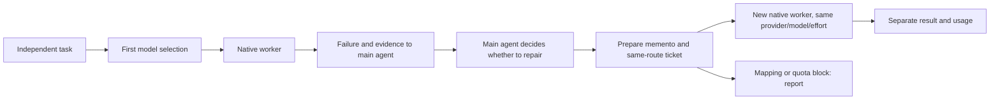

# Same-model repair handoff

**v0.1.9 experimental — implemented, not runtime-verified.**

The project author proposed this change: GeneralRouter selects a configuration once for an independent task. If execution or acceptance fails, the main agent receives the failure and decides whether to arrange a repair. A repair starts a **new native subagent with the same frozen provider, model and effort**. It does not re-enter candidate matching.

## The sequence

1. The main agent gives the original task a profile. GeneralRouter ranks eligible candidates once and returns a fixed route and dispatch ticket.
2. The main agent dispatches the native worker. Execution outcome, reported acceptance and usage are recorded separately.
3. Failure evidence returns to the main agent. It decides whether a repair is within the request and stopping conditions, then prepares a concise memento.
4. `generalrouter_prepare_repair` creates a linked task, inherits the fixed route and checks mapping and quota admission. It returns the usual dispatch arguments and a fresh ticket without calculating scores, new task weights or native-allowlist membership.
5. The main agent dispatches a new native subagent. Existing files, the working directory, original constraints and the memento provide continuity. The predecessor remains closed.
6. The repair receives its own execution, acceptance and usage records. A successful repair does not rewrite the original failure.



The backend is still involved in record retention, mapping checks, dispatch-ticket and route-identity authorization, quota admission and accounting. Those operations do not constitute another model choice. v0.1.9 does not check native-catalog or allowlist membership here; missing catalog metadata does not block handoff. The repair preserves the exact frozen effort, including default when originally selected. Mapping/quota blocks and actual DSH invocation rejections are reported to the main agent without substituting a different model, provider or effort. No automatic repair loop is introduced.

## Tool contract

```text
generalrouter_prepare_repair(
    profile_id,
    repairs_task_id,
    task_id,
    objective,
    memento,
    input_artifacts?,
    detail?
)
```

| Argument | Purpose |
| --- | --- |
| `profile_id` | Identify the existing plan in the current run. |
| `repairs_task_id` | Identify the ended predecessor whose outcome and frozen route are retained. |
| `task_id` | Give the new repair a distinct identity. |
| `objective` | State the remaining defect and required correction. |
| `memento` | A nonempty string carrying concise attempts, observed failures, evidence references and proposed next steps. |
| `input_artifacts` | An optional string array of relevant existing files or evidence paths. |
| `detail` | Request detailed output when needed. |

The main agent retains the returned dispatch fields and ticket when calling native `subagent`. Preparing a repair does not itself execute one. `generalrouter_record_acceptance` continues to store reported acceptance; it does not perform the checks. Unknown results remain unknown.

`generalrouter_append_task` remains available for **independent additional work**, followed by that task's first match. It is not the repair path. Repair must not be disguised as an independent task merely to obtain another model selection. The original profile remains unchanged.

## What a memento contains

Use a short working note that a fresh worker can act on:

- What was attempted and which files were changed.
- What failed, including expected versus actual behavior.
- Where the failure evidence and any actual check output are saved.
- What remains to do and the next step worth trying.

Keep the original task's scope and constraints. Do not replace evidence with a success assertion, copy the entire transcript, or present unrun checks as completed. The new worker reads relevant existing files and the note instead of relying on the predecessor's conversation state.

The memento idea is informed by Appendix A of Anthropic's [self-replicating AI research](https://www.anthropic.com/research/self-replicating-ai): a fresh agent instance inherits code, environment and brief notes about prior strategies, failures and performance. GeneralRouter adopts that continuity pattern for main-agent-directed repairs, not replication. The reference does not establish this project's performance.

## Change from v0.1.7

v0.1.7 allowed a repair to be appended as a linked task and matched again. v0.1.8 replaces that model-selection step with inheritance of the frozen route. No new task-weight estimate is needed for repair. Independent tasks still use the existing four-dimensional scoring algorithm.

v0.1.9 follows the project author's request to remove Router-side native membership prechecks from initial matching, frozen retries, repairs and authorization. DSH's invocation permissions and user settings remain unchanged. This does not add dispatch through other execution plugins or verify that all twelve configurations can run.

The original task and repair can be grouped for total resource reporting without adding that grouped view to the per-task total again. A repair has extra failure information, so it is not an identical repeat or a clean same-prompt model comparison.

Previous v0.1.7 experiments and results remain historical evidence of that version. This architecture change does not add a new experiment, demonstrate savings or establish that repairs now succeed.
